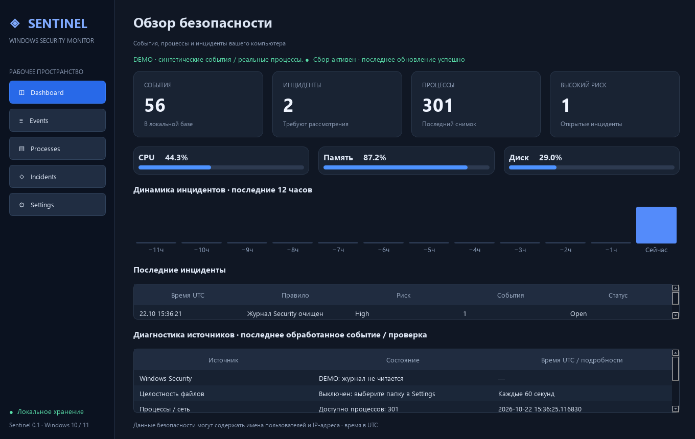
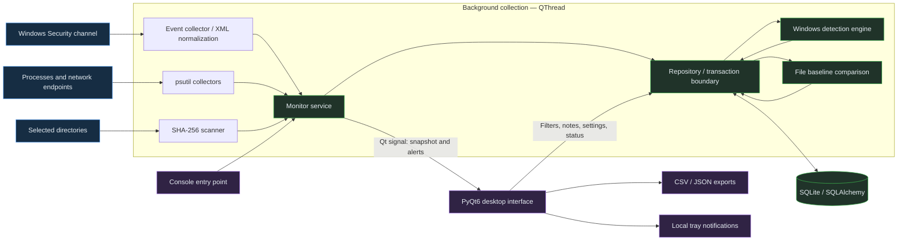
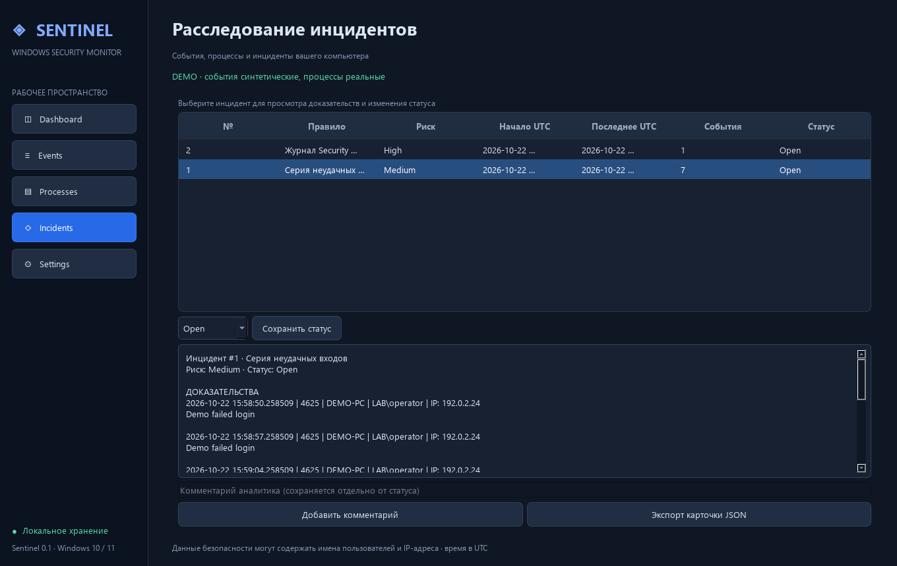
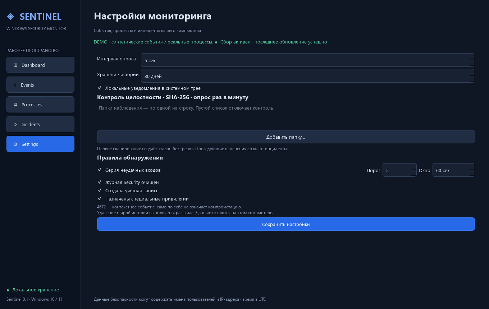

# 🛡️ Sentinel — Windows Security Monitor

**Local Windows security telemetry, rule-based detection, and evidence-driven incident review.**

[](pyproject.toml)
[](#installation--usage)
[](#validation)
[](LICENSE)

**English** · [Русский](README.ru.md)

Sentinel is a Python desktop application for inspecting a Windows host's security events, process activity, and selected files. It combines local collection with explicit detection rules, persistent evidence, and a PyQt6 investigation interface.

Designed for **Blue Team labs, detection engineering, and local incident triage**. This is an experimental host-monitoring tool, not a full EDR, antivirus, or centralized SIEM. The current UI is primarily in Russian; navigation and status identifiers use English.



*Actual application rendered with Qt offscreen. Security events are seeded demo data; resource metrics and process counts are real measurements from the capture session.*

**Explore:** [Features](#key-features) · [Detection](#detection-engineering) · [Architecture](#system-architecture) · [Demo](#demonstration) · [Run](#installation--usage) · [Security](#security-considerations) · [Roadmap](#development-roadmap)

## Key Features

| Capability | Implemented behavior |
| --- | --- |
| **Windows Event Log Analysis** | Reads the local `Security` channel through pywin32; retains selected event IDs, source record IDs, normalized fields, and original XML. |
| **Threat Detection** | Correlates repeated failed logons; raises incidents for log clearing, account creation, and special-privilege assignment. Severity expresses triage priority, not a malware verdict. |
| **Process Monitoring** | Collects PID, start time, executable path, owner, CPU, RSS, and available TCP/UDP endpoints using psutil. |
| **Incident Tracking** | Persistent evidence links, analyst comments, status history, false-positive disposition, and complete incident-card JSON export. |
| **Security Dashboard** | Event totals, active incidents, process count, high-risk incidents, utilization, a 12-hour incident histogram, and source diagnostics. |
| **File Integrity Monitoring** | SHA-256 baselines for selected directories; incidents for added, changed, and deleted files after initialization. |
| **Filtering & Reporting** | Filter by time, event ID, and associated incident severity; CSV/JSON export of displayed results, capped at 500 events. |
| **Local Notifications** | Optional system-tray messages in live GUI mode, limited to the first five new alerts per cycle. |

## Detection Engineering

### Detection catalog

All four Windows detection rules are enabled by default. Settings can disable each rule and change the failed-logon threshold and window.

| Source / ID | Observation | Detection behavior | Severity |
| --- | --- | --- | --- |
| Security / **4625** | Failed logon | At least **5 events within 60 seconds**, grouped by source computer, normalized account, and IP | Medium |
| Security / **4624** | Successful logon | Store for inspection; no detection rule | — |
| Security / **4634** | Logoff | Store for inspection; no detection rule | — |
| Security / **4672** | Special privileges assigned to a new logon | One incident per unique event; contextual signal without an account allowlist | Low |
| Security / **4720** | User account created | One incident per unique event | Medium |
| Security / **1102** | Security audit log cleared | One incident per unique event | High |
| FileIntegrity / **9001** | File added, modified, or deleted | One incident per observed path change after the initial baseline | Medium |

`9001` is an **application-generated identifier**, not a Windows auditing event. File-change detection runs in the repository's baseline transaction, independently of the Windows rule engine.

### From raw records to evidence

1. **Collect:** query Security in forward record order, retrieving up to 256 records per cycle.
2. **Normalize:** parse XML `System`, `EventData`, and `UserData`; extract time, record ID, computer, account, and IP. Preserve the XML.
3. **Deduplicate:** check `(channel, source, record_id, timestamp)`, also enforced by a database uniqueness constraint.
4. **Evaluate:** run the applicable rule against persisted events inside the ingestion transaction.
5. **Record:** insert or update the incident and evidence links; commit the source checkpoint in the same transaction.
6. **Present:** send a snapshot to the GUI; return a notification payload only for a newly created incident.

### Failed-logon correlation

For an incoming 4625 at time `t`, matching events are counted in the **inclusive** interval `[t − window, t]`. Account normalization prefixes the available domain. Unavailable IP values such as `-` become an empty string: missing IP alone never triggers a rule, but matching events with empty IPs can still reach the threshold.

At the threshold, the engine reuses the newest incident with the same series key whose `last_seen` falls within the window. Evidence links are added once; `event_count` tracks accumulated distinct evidence and can exceed the threshold. A qualifying series outside that window creates a new incident.

> [!NOTE]
> Closed and false-positive incidents can receive additional evidence inside the correlation window. Their status is preserved; they are not automatically reopened. The detector assumes ordered ingestion and does not recompute past windows for arbitrarily reordered imports.

**Reproducible example:** on a fresh demo database, [`seed_demo()`](app/services/monitor.py) inserts 48 successful logons, seven failed logons for `LAB\operator` / `192.0.2.24` within 42 seconds, and one log-clear event. These 56 events produce one Medium failed-logon incident with seven evidence records and one High log-clear incident. These are synthetic inputs, not a captured attack.

### File integrity semantics

The first complete scan establishes a baseline without alerts. Later scans compare SHA-256 digests and commit the new baseline, event, incident, and evidence link atomically. Evidence includes the path, change type, previous hash, and current hash; the absent side is `null` for creation or deletion.

Scanning is scheduled approximately once per minute in the collection worker. Symbolic links and junction directories are skipped. Limits are **10,000 files per root** and **128 MiB per file**. Unreadable files, exceeded limits, or detected changes during hashing abort that root's scan; its previous baseline remains intact. Disabling a root preserves its baseline for later comparison.

## System Architecture



Collectors do not import PyQt6. Windows events cross the collector boundary as immutable `EventData` dataclasses; process rows and monitor snapshots currently use dictionaries. The service coordinates collection, detection, storage, and cleanup. Repository methods own sessions and transactions. The GUI receives snapshots through Qt signals and performs bounded reads and user-driven writes through the repository.

Collection and detection run outside the GUI thread. Collectors run **sequentially within one worker**: an expensive file scan can delay the next event poll. The console path uses the same service without starting Qt.

<details>
<summary><strong>Repository map</strong></summary>

```text
app/
├── main.py                  # GUI / console entry point and rotating logs
├── collectors/
│   ├── windows_events.py    # Event Log API and checkpoint validation
│   ├── processes.py         # Process snapshots with nullable protected fields
│   ├── network.py           # Connection snapshot grouped by PID
│   └── integrity.py         # Bounded SHA-256 directory scans
├── detection/
│   ├── engine.py            # SQL-backed correlation and incident evidence
│   └── rules.py             # Built-in rules and event labels
├── database/
│   ├── models.py            # EventData and eight ORM tables
│   └── repository.py        # Transactions, queries, baselines, retention
├── services/                # Monitor orchestration, exports, alert formatting
└── ui/                      # Dashboard, Events, Processes, Incidents, Settings
config/defaults.json         # Reference defaults; not runtime configuration
docs/images/                 # Actual application captures for the READMEs
scripts/verify_ui.py          # Offscreen captures and dashboard timing probe
tests/                       # pytest unit, integration, and Qt checks
launch.bat                   # Windows launcher using the local virtualenv
requirements.txt
pyproject.toml
```

</details>

## Technical Implementation

| Engineering decision | Implementation and trade-off |
| --- | --- |
| **Windows API integration** | pywin32 wraps `EvtQuery`, `EvtNext`, and `EvtRender`. Event/query handles close in `finally`. Malformed/render-failed records are logged and skipped; a later valid record advances the checkpoint. |
| **Checkpoint recovery** | Validates saved RecordID against its timestamp. If the record disappeared or changed, replays retained records with deduplication. It cannot recover records already overwritten or cleared. |
| **Timestamp handling** | Normalizes to UTC, stored as timezone-naive UTC datetimes; UI timestamps are labeled UTC. |
| **Process identity** | Stores start time alongside PID to retain reuse context. Network data is a separate PID-grouped snapshot, not an atomic process/connection correlation. Protected fields remain nullable. |
| **Transactional detection** | SQL-backed windows survive restart. Ingestion, detection output, evidence links, and checkpoint commit or roll back together. |
| **SQLite operation** | WAL, enabled foreign keys, a 15-second connection timeout, parameterized ORM queries, event-series indexes, and unique evidence links. One collector per database is supported. |
| **Analyst workflow** | `Open`, `Investigating`, `Resolved`, `FalsePositive`; status changes become notes. Only the first two count as active. Notes are not an authenticated, tamper-evident audit trail. |
| **Reporting** | CSV prefixes text beginning with common spreadsheet formula characters with an apostrophe. JSON preserves structured evidence and notes. Exports are local and user-initiated. |
| **Error visibility** | Security failures are surfaced and retried on later cycles. Diagnostics expose source status and the latest-vs-checkpoint RecordID gap, not a precise backlog count. |

### Persistence and retention

| Table | Purpose |
| --- | --- |
| `security_events` | Normalized events, original XML or file-change JSON, source record identity |
| `process_snapshots` | Time-stamped process metrics and serialized connection information |
| `incidents` | Rule, severity, status, series identity, first/last seen, evidence count |
| `incident_events` | Unique many-to-many links between incidents and events |
| `detection_rules` | Enabled state and failed-logon correlation parameters |
| `settings` | Runtime settings, event checkpoint, baseline-initialization markers |
| `file_baselines` | Last accepted SHA-256 digest per root and path |
| `investigation_notes` | Analyst comments and status-change history |

Cleanup runs on the first eligible cycle and approximately hourly thereafter. It removes old incidents **regardless of status**, dependent notes/links, old process snapshots, and old events not linked to retained incidents. The default is 30 days: long-running investigations require timely export or longer retention. Baselines do not expire through cleanup. SQLite reuses deleted space; automatic compaction is not implemented.

`create_all()` creates missing tables, including integrity and notes tables for older databases. There is no versioned migration framework or automatic alteration of existing columns.

## Demonstration

These are captures of actual PyQt6 widgets, not mockups. Demo security events are synthetic; no production incident evidence is shown.

| Investigation workflow | Integrity configuration |
| --- | --- |
| [](docs/images/incidents.png) | [](docs/images/settings.png) |

Run `--demo` for a separate seeded database. Seeding occurs only when there are no events, so later launches preserve investigation changes. Demo skips Security collection and suppresses tray messages; it still reads real process/network/resource data, and file monitoring works if roots are configured in demo settings.

For a file-change walkthrough, choose a small test directory in **Settings**, save, and wait for a successful scan in **Dashboard → source diagnostics**. Edit a test file, wait for the next scan, then open its incident to inspect hashes, add a comment, and change status. An unchanged file does not create repeated alerts.

## Installation & Usage

### Prerequisites

- Windows 10/11 x64 is the target platform; local validation used Windows with Python **3.14.4**.
- Python **3.12+** and Git for cloning. A source archive can replace Git.
- Access to the local Security log for live collection; unavailable access is reported in the UI.

From PowerShell:

```powershell
git clone https://github.com/LittleGers214/sentinel-windows-monitor.git
cd sentinel-windows-monitor
python -m venv .venv
.\.venv\Scripts\python.exe -m pip install -r requirements.txt
.\.venv\Scripts\python.exe -m app.main
```

Direct use of the virtualenv interpreter avoids changing PowerShell's activation-script policy. Dependencies are declared in [`requirements.txt`](requirements.txt); there is no lockfile. The stack is PyQt6, pywin32, psutil, SQLAlchemy, and SQLite.

```powershell
# Separate demo database; synthetic security events, real process metrics
.\launch.bat --demo

# Continuous console monitoring; Ctrl+C stops it
.\launch.bat --console

# One console cycle with an explicit local database
.\launch.bat --once --db .\artifacts\local.db
```

`launch.bat` requires an existing `.venv`. `--demo` and `--db` cannot be combined. Close the current instance before starting another against the same database. The application is not a Windows service: closing the GUI stops collection after the current cycle.

### Configuration and local data

| Setting / artifact | Default or behavior |
| --- | --- |
| Poll interval | 5 seconds of wait between cycles; configurable from 1–300 seconds |
| Failed-logon rule | 5 events / 60 seconds; UI ranges: 1–10,000 events / 1–86,400 seconds |
| Retention | 30 days; configurable from 1–3,650 days |
| Integrity roots | Empty / disabled; set in Settings; target interval 60 seconds |
| Notifications | Enabled; local tray only, live GUI mode |
| Live database | `%LOCALAPPDATA%\Sentinel\sentinel.db` |
| Demo database | `%LOCALAPPDATA%\Sentinel\demo.db` |
| Application logs | `sentinel.log` beside the database; 2,000,000-byte rotation, three backups |

Settings are persisted in SQLite. [`config/defaults.json`](config/defaults.json) is a reference, **not a loaded configuration file**. A monitored root cannot contain the working database directory, preventing monitoring of Sentinel's changing database files.

## Security Considerations

### Access and Windows Audit Policy

Sentinel does not enable auditing, change services, grant privileges, or elevate itself. Use an account with the required channel access under your organization's policy. An empty event table is not evidence of a secure host.

| Telemetry | Relevant audit subcategory |
| --- | --- |
| 4624 / 4625 | Audit Logon: success / failure |
| 4634 | Audit Logoff: success |
| 4672 | Audit Special Logon: success |
| 4720 | Audit User Account Management: success |

Validate auditing and log availability on the monitored host. See Microsoft's [Audit Logon](https://learn.microsoft.com/windows/security/threat-protection/auditing/audit-logon) and [Audit User Account Management](https://learn.microsoft.com/en-us/previous-versions/windows/it-pro/windows-10/security/threat-protection/auditing/audit-user-account-management). Event 1102 reports log clearing; observing it does not restore the removed records.

### Collection and detection boundaries

- **Polling, not a lossless stream:** retained history is read in batches of 256; heavy traffic can outpace collection. Historical events may generate new notifications. Rapid changes between file scans can be missed.
- **Analyst context is required:** 4672 is common for legitimate privileged activity. No account allowlist, behavioral model, signature verification, automatic blocking, or process termination is implemented.
- **Files are checked by content:** metadata-only changes are not detected. Stat/read checks reduce inconsistent hashing but do not provide atomic snapshots or protection from adversarial filesystem races. Choose small, stable directories.
- **Process data is best effort:** access restrictions and exit races can omit fields or rows. Initial CPU measurements may be zero; multicore process CPU can exceed 100%.
- **UI scope:** event/incident lists show at most 500 records. Severity filtering selects events linked to incidents of that severity. The incident view refreshes on navigation or local edits, rather than replacing evidence continuously during review.

### Data protection

Data stays local unless the user exports or shares it. There is no Telegram or cloud integration. XML, account names, IP addresses, executable paths, connection metadata, notes, and exports may be sensitive.

The database and diagnostic logs are **not encrypted, signed, or tamper-resistant**. Access follows Windows filesystem permissions; Sentinel does not harden ACLs. A privileged local attacker can stop the monitor or alter its records. Use suitable ACLs, disk protection, backups, and independent logging where evidence preservation matters. Do not commit databases, logs, or real investigation exports; `.gitignore` excludes runtime databases and logs.

## Validation

```powershell
.\.venv\Scripts\python.exe -m pip install pytest ruff
.\.venv\Scripts\python.exe -m pytest -q
.\.venv\Scripts\python.exe -m ruff check app tests scripts
.\.venv\Scripts\python.exe -m ruff format --check app tests scripts
.\.venv\Scripts\python.exe scripts\verify_ui.py
```

**Observed local result:** 18 tests passed on Windows / Python 3.14.4 during documentation preparation. This is not a CI status or coverage claim.

| Area | Verified scenarios |
| --- | --- |
| Detection | Four vs. five failures; inclusive window boundary; account/IP separation; subsequent series |
| Persistence | Duplicate reads, restart continuity, rollback, retention cascades, older-schema table creation |
| Collectors | XML parsing, invalid XML, checkpoint reset/resume, unavailable Security log and process fields |
| Integrity | Initial baseline, change/create/delete, restart, failed-scan preservation, missing directory |
| Investigation & UI | Notes, false-positive status, navigation, event-loop activity while a worker is slow |
| Reporting | JSON output and CSV formula-prefix handling |

`verify_ui.py` renders five screens and measures warm Dashboard construction plus first offscreen paint with **10,056 events**. It excludes Python startup, dependency loading, real Security collection, and sustained load; it is not an end-to-end startup SLA.

> [!IMPORTANT]
> The live Security collection attempt in the development environment returned Windows error **1722: RPC server unavailable**. Successful live Security ingestion and native tray delivery still need validation on an appropriately configured Windows host. Process collection and offscreen UI checks have run successfully.

## Development Roadmap

These are **planned improvements**, not current capabilities.

- [ ] Windows integration tests with controlled audit-policy and permission scenarios.
- [ ] Faster backlog handling, bounded retries, late/out-of-order event handling, and collection health metrics.
- [ ] Independent scheduling/cancellation for file scans; exclusions, UI limits, and explicit baseline reset.
- [ ] Context-aware suppression/allowlists and additional tested detection rules.
- [ ] Process lineage, command-line context, executable signature checks, and stronger PID/connection correlation.
- [ ] Versioned migrations, retention controls for active investigations, and paginated/full exports.
- [ ] Windows service/installer packaging and broader Python/Windows CI coverage.
- [ ] Opt-in external notifications with secure secret storage; English UI localization.

## License

Licensed under the [MIT License](LICENSE), as already declared in this repository. This project is independent of Microsoft Sentinel.
