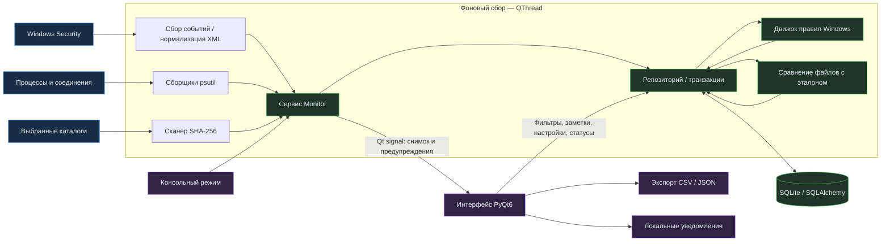

# 🛡️ Sentinel — Windows Security Monitor

**Локальная телеметрия безопасности Windows, обнаружение по правилам и расследование на основе доказательств.**

[](pyproject.toml)
[](#установка-и-запуск)
[](#проверка)
[](LICENSE)

[English](README.md) · **Русский**

Sentinel — десктопное приложение на Python для анализа событий безопасности Windows, активности процессов и изменений выбранных файлов. Локальный сбор объединён с явными правилами обнаружения, сохранением доказательств и интерфейсом расследования на PyQt6.

Проект предназначен для **лабораторий Blue Team, разработки детектов и локального разбора инцидентов**. Это экспериментальный монитор хоста, а не полноценный EDR, антивирус или централизованная SIEM. Интерфейс преимущественно русскоязычный; названия разделов и идентификаторы статусов — английские.


*Снимок настоящего приложения через Qt offscreen. События безопасности демонстрационные; показатели ресурсов и число процессов получены при съёмке.*

**Навигация:** [Возможности](#основные-возможности) · [Детекты](#detection-engineering) · [Архитектура](#архитектура-системы) · [Демо](#демонстрация) · [Запуск](#установка-и-запуск) · [Безопасность](#безопасность-и-ограничения) · [Планы](#план-развития)

## Основные возможности

| Направление | Что реализовано |
| --- | --- |
| **Windows Event Log Analysis** | Локальный канал `Security` через pywin32; выбранные Event ID, RecordID, нормализованные поля и исходный XML. |
| **Threat Detection** | Корреляция неудачных входов; инциденты при очистке журнала, создании пользователя и назначении специальных привилегий. Риск — приоритет анализа, а не вердикт о вредоносности. |
| **Process Monitoring** | PID, время запуска, путь, владелец, CPU, RSS и доступные TCP/UDP-соединения через psutil. |
| **Incident Tracking** | Доказательства, комментарии, история статусов, отметка ложного срабатывания и экспорт полной карточки в JSON. |
| **Security Dashboard** | События, активные инциденты, процессы, высокий риск, ресурсы хоста, динамика за 12 часов и диагностика источников. |
| **Контроль файлов** | Эталоны SHA-256 выбранных каталогов; инциденты при создании, изменении и удалении после первого сканирования. |
| **Фильтры и отчёты** | Отбор по времени, Event ID и риску связанного инцидента; CSV/JSON отображаемых результатов, до 500 событий. |
| **Уведомления** | Локальный трей в обычном GUI-режиме; не более первых пяти новых предупреждений за цикл. |

## Detection Engineering

### Каталог детектов

Все четыре правила Windows включены по умолчанию. В Settings можно отключить каждое правило и изменить порог и окно серии неудачных входов.

| Источник / ID | Наблюдение | Реакция | Риск |
| --- | --- | --- | --- |
| Security / **4625** | Неудачный вход | Не менее **5 событий за 60 секунд** для одинаковых компьютера-источника, нормализованного аккаунта и IP | Medium |
| Security / **4624** | Успешный вход | Сохранение, без детекта | — |
| Security / **4634** | Завершение сеанса | Сохранение, без детекта | — |
| Security / **4672** | Специальные привилегии при входе | Один инцидент на уникальное событие; контекстный сигнал без allowlist аккаунтов | Low |
| Security / **4720** | Создание пользователя | Один инцидент на уникальное событие | Medium |
| Security / **1102** | Очистка журнала Security | Один инцидент на уникальное событие | High |
| FileIntegrity / **9001** | Создание, изменение или удаление файла | Один инцидент на наблюдаемое изменение пути после создания эталона | Medium |

`9001` — **внутренний идентификатор приложения**, а не событие аудита Windows. Сравнение файлов выполняется в транзакции репозитория, отдельно от движка правил Windows.

### От исходной записи до доказательства

1. **Сбор:** Security в прямом порядке RecordID, до 256 записей за цикл.
2. **Нормализация:** разбор XML `System`, `EventData`, `UserData`; извлечение времени, RecordID, компьютера, аккаунта и IP. Исходный XML сохраняется.
3. **Дедупликация:** проверка `(channel, source, record_id, timestamp)` и уникальное ограничение базы.
4. **Анализ:** выполнение правила по сохранённым событиям в транзакции приёма.
5. **Регистрация:** создание/обновление инцидента, связи с доказательствами и атомарное сохранение позиции чтения.
6. **Отображение:** снимок передаётся в GUI; данные для уведомления возвращаются только при создании инцидента.

### Корреляция неудачных входов

Для 4625 с временем `t` учитывается **включительное** окно `[t − window, t]`. Доступный домен добавляется к имени аккаунта. Недоступный IP, включая `-`, сохраняется пустой строкой. Отсутствие IP само по себе не вызывает тревогу, но серия с одинаковым пустым IP может достичь порога.

После достижения порога используется последний инцидент с тем же ключом серии, если его `last_seen` попадает в окно. Каждая связь с доказательством добавляется один раз. `event_count` отражает накопленные уникальные доказательства и может превышать порог. Подходящая серия за пределами этого окна создаёт новый инцидент.

> [!NOTE]
> Закрытый инцидент или ложное срабатывание может получить новые доказательства внутри окна. Статус сохраняется, автоматического повторного открытия нет. Алгоритм рассчитан на последовательный приём и не пересчитывает прошлые окна для произвольно переставленного импорта.

**Воспроизводимый пример:** [`seed_demo()`](app/services/monitor.py) создаёт в пустой демо-базе 48 успешных входов, семь ошибок для `LAB\operator` / `192.0.2.24` за 42 секунды и событие очистки журнала. Итого 56 событий, один Medium-инцидент с семью доказательствами и один High-инцидент очистки. Это синтетический сценарий, не запись атаки.

### Семантика контроля файлов

Первое полное сканирование создаёт эталон без тревог. Последующие проходы сравнивают SHA-256; эталон, событие, инцидент и связь доказательства фиксируются одной транзакцией. Доказательство содержит путь, тип изменения и хеши до/после; отсутствующая сторона при создании/удалении равна `null`.

Проверка планируется примерно раз в минуту в потоке сбора. Символьные ссылки и junction-каталоги пропускаются. Лимиты: **10 000 файлов на корень**, **128 МиБ на файл**. Ошибка чтения, превышение лимита или обнаруженное изменение во время хеширования отменяют проход папки, сохраняя прежний эталон. Отключение папки не стирает эталон.

## Архитектура системы



Сборщики не импортируют PyQt6. События Windows передаются через неизменяемый `EventData`; строки процессов и снимки сервиса пока представлены словарями. Сервис координирует сбор, анализ, сохранение и очистку. Репозиторий управляет сессиями и транзакциями. GUI получает снимки сигналами Qt, выполняет ограниченные запросы и сохраняет действия пользователя через репозиторий.

Сбор и анализ вынесены из потока интерфейса. Сборщики работают **последовательно в одном worker**: долгое хеширование задерживает опрос журнала. Консоль использует тот же сервис без запуска Qt.

<details>
<summary><strong>Структура репозитория</strong></summary>

```text
app/
├── main.py                  # GUI / консоль, ротация логов
├── collectors/
│   ├── windows_events.py    # Windows Event Log API, checkpoint
│   ├── processes.py         # Снимки процессов, nullable-поля
│   ├── network.py           # Соединения с группировкой по PID
│   └── integrity.py         # Ограниченные сканирования SHA-256
├── detection/
│   ├── engine.py            # Корреляция через SQL и доказательства
│   └── rules.py             # Встроенные правила и названия событий
├── database/
│   ├── models.py            # EventData и восемь ORM-таблиц
│   └── repository.py        # Транзакции, запросы, эталоны, очистка
├── services/                # Мониторинг, отчёты, уведомления
└── ui/                      # Dashboard, Events, Processes, Incidents, Settings
config/defaults.json         # Справочные значения, не рабочий конфиг
docs/images/                 # Реальные снимки интерфейса для README
scripts/verify_ui.py          # Снимки Qt offscreen и замер Dashboard
tests/                       # pytest: модули, интеграция, интерфейс
launch.bat                   # Запуск через локальное окружение
requirements.txt
pyproject.toml
```

</details>

## Техническая реализация

| Решение | Реализация и компромиссы |
| --- | --- |
| **Windows API** | `EvtQuery`, `EvtNext`, `EvtRender` через pywin32. Дескрипторы закрываются в `finally`. Повреждённые записи журналируются и пропускаются; checkpoint продвигает следующая корректная запись. |
| **Восстановление чтения** | RecordID проверяется вместе с временем. При исчезновении/замене перечитывается доступная история с дедупликацией. Очищенные и перезаписанные события не восстанавливаются. |
| **Время** | Нормализация в UTC, хранение datetime без timezone с договорённостью UTC; интерфейс указывает UTC. |
| **Процессы** | Вместе с PID сохраняется время запуска. Соединения собираются отдельно и связываются по PID: атомарной корреляции нет. Защищённые поля могут быть недоступны. |
| **Транзакции** | Окна в SQL переживают перезапуск. Приём события, анализ, доказательства и checkpoint фиксируются либо откатываются вместе. |
| **SQLite** | WAL, внешние ключи, timeout 15 секунд, параметризованные ORM-запросы, индексы поиска серий, уникальные связи доказательств. Один сборщик на базу. |
| **Расследование** | `Open`, `Investigating`, `Resolved`, `FalsePositive`; изменения статуса записываются в заметки. Первые два статуса активные. История не является аутентифицированным защищённым аудитом. |
| **Экспорт** | В CSV текст с типичными префиксами формул предваряется апострофом. JSON сохраняет структурированные доказательства и заметки. Экспорт локальный, по действию пользователя. |
| **Диагностика** | Сбой Security отображается, чтение повторяется. Разница текущего и обработанного RecordID — индикатор отставания, не точное число непрочитанных событий. |

### База и срок хранения

| Таблица | Назначение |
| --- | --- |
| `security_events` | Нормализованные события, XML или JSON изменения файла, идентификатор источника |
| `process_snapshots` | Метрики процессов и соединения на момент сбора |
| `incidents` | Правило, риск, статус, ключ серии, первое/последнее время, число доказательств |
| `incident_events` | Уникальные связи многие-ко-многим инцидентов и событий |
| `detection_rules` | Включение правил и параметры серии ошибок входа |
| `settings` | Настройки, checkpoint, маркеры инициализации эталонов |
| `file_baselines` | Последний принятый SHA-256 для корня и пути |
| `investigation_notes` | Комментарии и история статусов |

Очистка выполняется в первом подходящем цикле, затем примерно раз в час. Удаляются старые инциденты **независимо от статуса**, их заметки/связи, снимки процессов и старые события, не связанные с сохранёнными инцидентами. Срок по умолчанию — 30 дней: для длительного расследования нужен экспорт или увеличение срока. Эталоны автоматически не истекают. SQLite переиспользует свободное место; автоматического сжатия файла нет.

`create_all()` создаёт недостающие таблицы, включая эталоны и заметки в старой базе. Версионированных миграций и автоматического изменения существующих колонок нет.

## Демонстрация

Это настоящие виджеты PyQt6, не макеты. События синтетические; реальные материалы расследований не публикуются.

| Расследование | Настройка контроля файлов |
| --- | --- |
| [](docs/images/incidents.png) | [](docs/images/settings.png) |

`--demo` использует отдельную базу. Наполнение выполняется только при отсутствии событий, последующие запуски сохраняют действия аналитика. В демо не читается Security и не отправляются tray-уведомления; настоящие процессы, соединения и ресурсы собираются, контроль выбранных папок работает.

Для проверки файлов добавьте небольшой тестовый каталог в **Settings**, сохраните настройки и дождитесь успешного прохода в диагностике **Dashboard**. Измените тестовый файл, дождитесь следующего сканирования и откройте инцидент: доступны хеши, комментарий и смена статуса. Неизменившийся файл не создаёт повторных тревог.

## Установка и запуск

### Требования

- Целевая платформа — Windows 10/11 x64. Локальные проверки выполнены на Windows с Python **3.14.4**.
- Python **3.12+**, Git для клонирования. Можно использовать архив исходников вместо Git.
- Доступ к Security для реальных событий; отказ отображается в интерфейсе.

В PowerShell:

```powershell
git clone https://github.com/LittleGers214/sentinel-windows-monitor.git
cd sentinel-windows-monitor
python -m venv .venv
.\.venv\Scripts\python.exe -m pip install -r requirements.txt
.\.venv\Scripts\python.exe -m app.main
```

Прямой запуск интерпретатора не требует изменения политики выполнения скриптов PowerShell. Диапазоны зависимостей заданы в [`requirements.txt`](requirements.txt); lockfile отсутствует. Стек: PyQt6, pywin32, psutil, SQLAlchemy, SQLite.

```powershell
# Отдельная демо-база: синтетические события, реальные метрики
.\launch.bat --demo

# Непрерывный консольный монитор; остановка Ctrl+C
.\launch.bat --console

# Один цикл с явным путём к базе
.\launch.bat --once --db .\artifacts\local.db
```

Для `launch.bat` нужна готовая `.venv`. `--demo` несовместим с `--db`. Закройте текущий экземпляр перед запуском другого с той же базой. Приложение не служба: закрытие GUI завершает сбор после текущего цикла.

### Настройки и локальные данные

| Параметр / файл | Значение или поведение |
| --- | --- |
| Опрос | Ожидание 5 секунд между циклами; настройка 1–300 секунд |
| Ошибки входа | 5 событий / 60 секунд; диапазоны UI: 1–10 000 событий / 1–86 400 секунд |
| Хранение | 30 дней; настройка 1–3 650 дней |
| Файлы | Пустой список / отключено; каталоги в Settings, целевой интервал 60 секунд |
| Уведомления | Включены; локальный трей, обычный GUI-режим |
| Рабочая база | `%LOCALAPPDATA%\Sentinel\sentinel.db` |
| Демо-база | `%LOCALAPPDATA%\Sentinel\demo.db` |
| Диагностические логи | `sentinel.log` рядом с базой; ротация по 2 000 000 байт, три резервных файла |

Настройки хранятся в SQLite. [`config/defaults.json`](config/defaults.json) — справочник, **он не загружается как рабочий конфиг**. Нельзя наблюдать каталог, содержащий рабочую папку базы: это предотвращает контроль постоянно меняющихся файлов самого Sentinel.

## Безопасность и ограничения

### Права и Windows Audit Policy

Sentinel не включает аудит, не меняет службы, не выдаёт привилегии и не повышает права. Используйте аккаунт с доступом к каналу согласно политике организации. Пустая таблица событий не доказывает безопасность хоста.

| Телеметрия | Подкатегория аудита |
| --- | --- |
| 4624 / 4625 | Audit Logon: success / failure |
| 4634 | Audit Logoff: success |
| 4672 | Audit Special Logon: success |
| 4720 | Audit User Account Management: success |

Проверяйте аудит и доступность журнала на наблюдаемом хосте. Документация Microsoft: [Audit Logon](https://learn.microsoft.com/windows/security/threat-protection/auditing/audit-logon), [Audit User Account Management](https://learn.microsoft.com/en-us/previous-versions/windows/it-pro/windows-10/security/threat-protection/auditing/audit-user-account-management). Событие 1102 сообщает об очистке, но не восстанавливает удалённые записи.

### Границы обнаружения

- **Опрос, а не поток без потерь:** пакеты по 256 записей могут отставать от интенсивного потока. Исторические события могут породить новые уведомления. Быстрые изменения файлов между проходами пропускаются.
- **Нужна оценка аналитика:** 4672 бывает штатным. Нет allowlist аккаунтов, поведенческой модели, проверки подписи, блокировки и завершения процессов.
- **Контролируется содержимое:** изменения только метаданных не обнаруживаются. Stat/read уменьшают риск неконсистентного хеша, но не дают атомарного снимка и защиты от намеренных гонок файловой системы. Выбирайте небольшие стабильные каталоги.
- **Процессы видны не полностью:** ограничения доступа и завершение процесса приводят к пропускам. Первый CPU может быть нулевым; на нескольких ядрах возможны значения выше 100%.
- **Границы UI:** списки событий/инцидентов — до 500 записей. Фильтр риска отбирает события связанных инцидентов. Карточка обновляется при переходе в раздел и локальных действиях, а не постоянно во время расследования.

### Защита данных

Данные остаются локальными до экспорта или передачи пользователем. Telegram и облачных интеграций нет. XML, аккаунты, IP, пути, соединения, заметки и отчёты могут содержать чувствительную информацию.

База и логи **не зашифрованы, не подписаны и не защищены от подмены**. Доступ определяется правами Windows; приложение не настраивает ACL. Привилегированный нарушитель может остановить монитор и изменить записи. Для сохранности доказательств нужны соответствующие ACL, защита диска, резервное копирование и независимое журналирование. Не публикуйте базы, логи и реальные отчёты; `.gitignore` исключает рабочие базы и логи.

## Проверка

```powershell
.\.venv\Scripts\python.exe -m pip install pytest ruff
.\.venv\Scripts\python.exe -m pytest -q
.\.venv\Scripts\python.exe -m ruff check app tests scripts
.\.venv\Scripts\python.exe -m ruff format --check app tests scripts
.\.venv\Scripts\python.exe scripts\verify_ui.py
```

**Локальный результат:** при подготовке документации на Windows / Python 3.14.4 прошли 18 тестов. Это не статус CI и не заявление о проценте покрытия.

| Область | Проверенные сценарии |
| --- | --- |
| Детекты | Четыре/пять ошибок, граница окна, разделение аккаунтов/IP, новая серия |
| Хранение | Дубли, перезапуск, rollback, каскадная очистка, добавление таблиц к старой схеме |
| Сборщики | XML, некорректный XML, reset/resume checkpoint, недоступный Security и поля процессов |
| Файлы | Первый эталон, создание/изменение/удаление, перезапуск, сохранение эталона при ошибке, отсутствующая папка |
| Расследование и UI | Заметки, FalsePositive, навигация, работа event loop при медленном worker |
| Экспорт | JSON и обработка префиксов формул в CSV |

`verify_ui.py` снимает пять экранов и измеряет построение прогретого Dashboard с первой отрисовкой offscreen на **10 056 событиях**. Не включены запуск Python, загрузка библиотек, реальный Security и длительная нагрузка. Это не SLA холодного запуска.

> [!IMPORTANT]
> Проверка реального Security в среде разработки вернула Windows **1722: RPC-сервер недоступен**. Успешное чтение защищённого журнала и нативные tray-уведомления ещё нужно проверить на настроенном Windows-хосте. Сбор процессов и проверки UI offscreen прошли успешно.

## План развития

Это **запланированные улучшения**, а не текущие возможности.

- [ ] Интеграционные тесты Windows с контролируемыми политиками аудита и правами.
- [ ] Ускорение обработки накопленного журнала, ограниченные повторы, запоздавшие события и метрики здоровья сбора.
- [ ] Независимое расписание/отмена сканирования файлов, исключения, лимиты в UI и сброс эталона.
- [ ] Контекстные исключения/allowlist и новые правила с тестами.
- [ ] Дерево процессов, командная строка, подписи исполняемых файлов, надёжнее связь PID/соединений.
- [ ] Версионированные миграции, сохранение активных расследований, пагинация и полный экспорт.
- [ ] Установщик/служба Windows и CI для нескольких версий Python/Windows.
- [ ] Внешние уведомления по явному согласию с защищённым хранением секретов; английская локализация UI.

## Лицензия

[MIT License](LICENSE), уже объявленная в репозитории. Проект не связан с продуктом Microsoft Sentinel.
